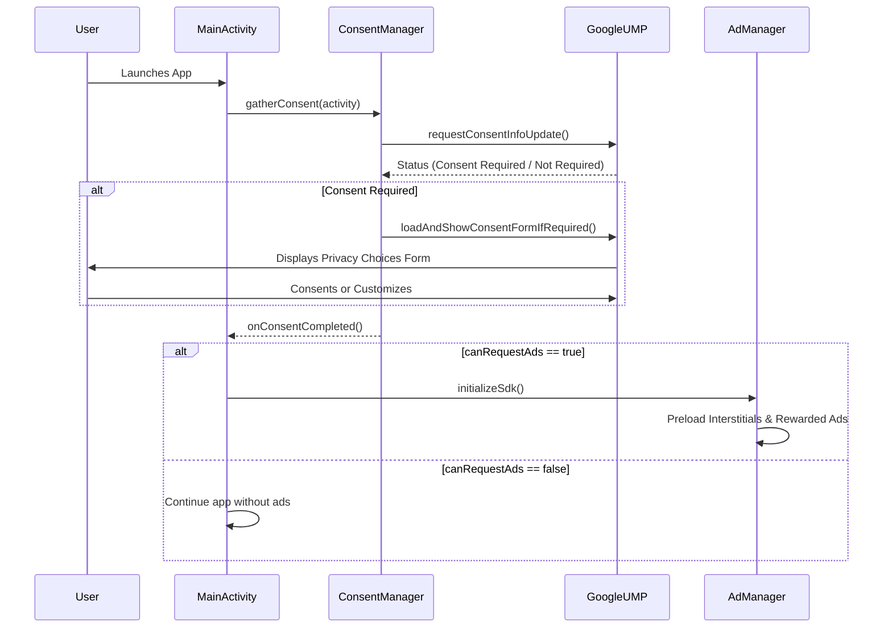
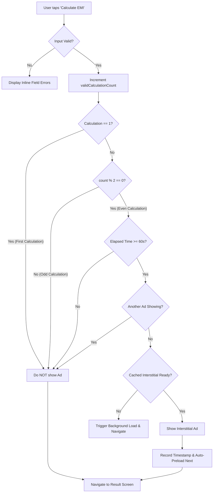
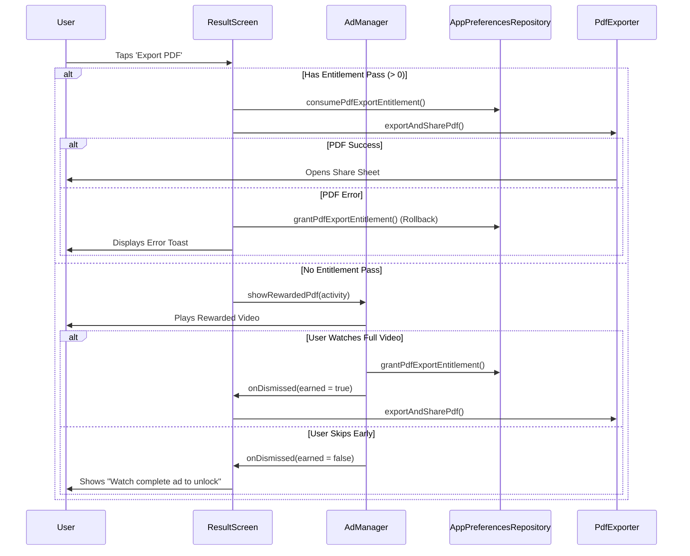

# AdMob Integration Architecture & Flow Guide
**Project:** EMI Calculator Android App  
**Tech Stack:** Kotlin, Jetpack Compose (Material 3), Google Mobile Ads SDK, Google User Messaging Platform (UMP)

---

## 1. Architectural Overview & Design Philosophy

The ad architecture is built around three core architectural principles:

1. **Strict Decoupling from UI Composables**:  
   Composables never make direct calls to the Google Mobile Ads SDK or instantiate ads directly. ViewModels coordinate business logic and query `AdPolicy` / `AdManager`, exposing only clean states, flows, and callbacks.
2. **Centralized Ad Policy Enforcement**:  
   All frequency caps, monotonic cooldown timers, first-launch exclusions, and concurrency locks reside centrally in [`AdPolicy.kt`](file:///Users/ravindrasolanki/AndroidStudioProjects/EmiCalculator/app/src/main/java/com/example/emicalculator/ads/AdPolicy.kt). Individual screens cannot bypass or inconsistently apply rules.
3. **Graceful Degradation (Fail-Safe User Experience)**:  
   Financial utilities must never freeze or lose calculation data if an ad fails to load, is throttled, or consent is withheld. In all failure/suppression paths, UI callbacks fire immediately.

```
                    ┌─────────────────────────┐
                    │     EmiApplication      │
                    │   (Process Lifecycle)   │
                    └────────────┬────────────┘
                                 │
                     ┌───────────▼───────────┐
                     │     MainActivity      │
                     │  (UMP Consent Check)  │
                     └───────────┬───────────┘
                                 │
        ┌────────────────────────┼────────────────────────┐
        │                        │                        │
┌───────▼────────┐      ┌────────▼────────┐      ┌────────▼────────┐
│ ConsentManager │◄─────┤    AdManager    ├─────►│    AdPolicy     │
│  (Google UMP)  │      │(AdMob Singleton)│      │(Cooldowns/Caps) │
└────────────────┘      └────────┬────────┘      └─────────────────┘
                                 │
     ┌──────────────────┬────────┼─────────┬──────────────────┐
     │                  │                  │                  │
┌────▼─────┐      ┌─────▼──────┐     ┌─────▼──────┐     ┌─────▼──────┐
│  Banner  │      │Interstitial│     │  Rewarded  │     │  App Open  │
│Compose UI│      │Cache/Player│     │Pass & Unlock│     │ Lifecycle  │
└──────────┘      └────────────┘     └────────────┘     └────────────┘
```

---

## 2. Configured Ad Placements & Google Test IDs

All ad units are logically separated in [`AdConstants.kt`](file:///Users/ravindrasolanki/AndroidStudioProjects/EmiCalculator/app/src/main/java/com/example/emicalculator/ads/AdConstants.kt) using official Google test IDs:

| Placement Name | Ad Format | Unit ID Constant | Google Test Unit ID | Location in App |
| :--- | :--- | :--- | :--- | :--- |
| **Application ID** | Meta-data | `APP_ID` | `ca-app-pub-3940256099942544~3347511713` | `AndroidManifest.xml` |
| **Home Banner** | Adaptive Banner | `BANNER_HOME` | `ca-app-pub-3940256099942544/9214589741` | Bottom of Home Screen |
| **Calculation Interstitial** | Interstitial | `INTERSTITIAL_CALCULATION` | `ca-app-pub-3940256099942544/1033173712` | Post-calculation flow |
| **Schedule Return Interstitial** | Interstitial | `INTERSTITIAL_SCHEDULE_RETURN` | `ca-app-pub-3940256099942544/1033173712` | Returning from Schedule |
| **Schedule Unlock** | Rewarded | `REWARDED_SCHEDULE_UNLOCK` | `ca-app-pub-3940256099942544/5224354917` | Results screen unlock button |
| **PDF Export** | Rewarded | `REWARDED_PDF_EXPORT` | `ca-app-pub-3940256099942544/5224354917` | Results screen PDF button |
| **Language Native** | Native Advanced | `NATIVE_LANGUAGE_SCREEN` | `ca-app-pub-3940256099942544/2247696110` | Settings / Language screen |
| **Onboarding Native A** | Native Advanced | `NATIVE_ONBOARDING_A` | `ca-app-pub-3940256099942544/1044960115` | Onboarding Step 1 |
| **Onboarding Native B** | Native Advanced | `NATIVE_ONBOARDING_B` | `ca-app-pub-3940256099942544/1044960115` | Onboarding Step 2 |
| **Result Native** | Native Advanced | `NATIVE_RESULT_SCREEN` | `ca-app-pub-3940256099942544/2247696110` | Bottom of Result screen |
| **App Open Ad** | App Open | `APP_OPEN_AD` | `ca-app-pub-3940256099942544/9257395921` | Foreground transition |

---

## 3. Consent Management Lifecycle (Google UMP)

Managed by [`ConsentManager.kt`](file:///Users/ravindrasolanki/AndroidStudioProjects/EmiCalculator/app/src/main/java/com/example/emicalculator/ads/ConsentManager.kt).

### Execution Flow:
1. **Activity Launch**: [`MainActivity.kt`](file:///Users/ravindrasolanki/AndroidStudioProjects/EmiCalculator/app/src/main/java/com/example/emicalculator/MainActivity.kt) invokes `ConsentManager.gatherConsent(activity)`.
2. **UMP Request**: Calls `consentInformation.requestConsentInfoUpdate(activity, params, ...)`.
3. **Form Presentation**: If consent is required by privacy regulations (GDPR/EEA, UK), `UserMessagingPlatform.loadAndShowConsentFormIfRequired()` opens the consent modal.
4. **SDK Initialization Gate**:
   - The app evaluates `consentManager.canRequestAds`.
   - If `true`, [`AdManager.initializeSdk()`](file:///Users/ravindrasolanki/AndroidStudioProjects/EmiCalculator/app/src/main/java/com/example/emicalculator/ads/AdManager.kt#L41) calls `MobileAds.initialize()`.
   - An `AtomicBoolean` ensures `MobileAds.initialize()` runs exactly once during the application process.
5. **On-Demand Privacy Re-Entry**:
   - The Settings screen checks `consentManager.isPrivacyOptionsRequired`.
   - When tapped, `ConsentManager.showPrivacyOptionsForm(activity)` opens the regulatory options dialog, allowing users to update their choices at any time.



---

## 4. Central Ad Frequency & Concurrency Policy

Rules are enforced in [`AdPolicy.kt`](file:///Users/ravindrasolanki/AndroidStudioProjects/EmiCalculator/app/src/main/java/com/example/emicalculator/ads/AdPolicy.kt):

### A. Calculation Interstitial Rules
- **1st Calculation**: Skipped (`validCalculationCount = 1` $\rightarrow$ returns `false`).
- **Subsequent Calculations**: Triggered only on every second calculation (`count % 2 == 0`, i.e., calculations 2, 4, 6...).
- **Minimum Interval**: At least **60 seconds** must have elapsed since the last interstitial was displayed anywhere in the app.
- **Monotonic Clocks**: All elapsed durations are calculated using `SystemClock.elapsedRealtime()`, preventing device clock manipulation from triggering ad storms.

### B. Schedule Return Interstitial Rules
- When the user presses the Back button or taps the Back icon on the Amortization Schedule screen, `AdPolicy.canShowScheduleReturnInterstitial()` is evaluated.
- It shares the same global 60-second minimum interval as the calculation interstitial.

### C. Onboarding Native Single-Display Rule
- Tracked via `onboardingNativeAShown` and `onboardingNativeBShown` flags.
- Native Ad A appears on onboarding slide 1; Native Ad B appears on slide 2.
- Each is rendered only once during the first-launch onboarding flow.

### D. App Open Ad Rules
- **First-Launch Suppression**: Disabled during the user's initial onboarding session (`isFirstLaunch = true`).
- **Cooldown**: Minimum **30 seconds** between successive App Open ad presentations.
- **Cache Age**: App Open ads older than **4 hours** are discarded and refreshed.

### E. Concurrency Exclusion Lock
- Managed via `AdPolicy.isFullScreenAdShowing = AtomicBoolean(false)`.
- Prevents any Interstitial, Rewarded, or App Open ad from overlapping if another full-screen ad is active.



---

## 5. Detailed Ad Format Implementations

### 1. Banner Ads
- **File**: [`ui/components/BannerAdView.kt`](file:///Users/ravindrasolanki/AndroidStudioProjects/EmiCalculator/app/src/main/java/com/example/emicalculator/ui/components/BannerAdView.kt)
- **Compose Bridge**: Uses `AndroidView` to instantiate Google's `AdView(context)`.
- **Size**: Set to `AdSize.BANNER` (320x50dp).
- **Cleanup**: In `DisposableEffect(adView)`, `adView.destroy()` is guaranteed upon composition teardown.

### 2. Native Ads
- **Files**:
  - Layout: [`app/src/main/res/layout/ad_unified_native.xml`](file:///Users/ravindrasolanki/AndroidStudioProjects/EmiCalculator/app/src/main/res/layout/ad_unified_native.xml)
  - Composable: [`ui/components/NativeAdComposable.kt`](file:///Users/ravindrasolanki/AndroidStudioProjects/EmiCalculator/app/src/main/java/com/example/emicalculator/ui/components/NativeAdComposable.kt)
- **Asset Registration**: Maps headline, body, call-to-action button, app icon, and advertiser views directly to `NativeAdView`.
- **Lifecycle Management**: Stores the loaded `NativeAd` in Compose state and invokes `nativeAd.destroy()` inside `DisposableEffect`.

### 3. Interstitial Ads
- **File**: [`ads/AdManager.kt`](file:///Users/ravindrasolanki/AndroidStudioProjects/EmiCalculator/app/src/main/java/com/example/emicalculator/ads/AdManager.kt#L64-L124)
- **Preload Strategy**: Preloads during app startup.
- **Auto-Reload**: When an interstitial is dismissed or fails to show, `loadInterstitial()` immediately caches the next ad for future eligible calculations.

### 4. Rewarded Ads & Entitlement Handling
- **Files**: [`ads/AdManager.kt`](file:///Users/ravindrasolanki/AndroidStudioProjects/EmiCalculator/app/src/main/java/com/example/emicalculator/ads/AdManager.kt#L126-L270), [`data/AppPreferencesRepository.kt`](file:///Users/ravindrasolanki/AndroidStudioProjects/EmiCalculator/app/src/main/java/com/example/emicalculator/data/AppPreferencesRepository.kt#L55-L75)
- **Separation of Placements**: Dedicated loaders and variables for Schedule Unlock (`rewardedScheduleAd`) and PDF Export (`rewardedPdfAd`).
- **Reward Verification**:
  ```kotlin
  var earned = false
  ad.show(activity) { rewardItem ->
      earned = true
      onRewardEarned() // Entitlement granted only here
  }
  ```
- **PDF Entitlement Rollback**:
  If a user has earned an export pass but the PDF writer encounters an I/O error, the entitlement is restored:
  ```kotlin
  preferencesRepository.grantPdfExportEntitlement() // Restores pass on failure
  ```



### 5. App Open Ads
- **File**: [`ads/AppOpenAdManager.kt`](file:///Users/ravindrasolanki/AndroidStudioProjects/EmiCalculator/app/src/main/java/com/example/emicalculator/ads/AppOpenAdManager.kt)
- **Process Lifecycle**: Implements `DefaultLifecycleObserver` and registers with `ProcessLifecycleOwner.get().lifecycle`.
- **Memory Safety**: Uses `WeakReference<Activity>` updated in `ActivityLifecycleCallbacks` to avoid activity leaks.
- **Foreground Trigger**: In `onStart(owner)`, retrieves current active activity, verifies `AdPolicy.canShowAppOpenAd()`, and renders if valid.

---

## 6. Production Migration Checklist

When transitioning from test ads to production AdMob accounts:

1. **Replace Test App ID in `AndroidManifest.xml`**:
   ```xml
   <meta-data
       android:name="com.google.android.gms.ads.APPLICATION_ID"
       android:value="ca-app-pub-XXXXXXXXXXXXXXXX~XXXXXXXXXX" />
   ```
2. **Update Unit IDs in `AdConstants.kt`**:
   Replace Google test constants with registered production ad unit IDs from your AdMob console.
3. **Configure `app-ads.txt`**:
   Publish your verified `app-ads.txt` file on your developer domain.
4. **Publish UMP Privacy Messages**:
   In your AdMob console under **Privacy & messaging**, publish GDPR and US State privacy consent forms.
